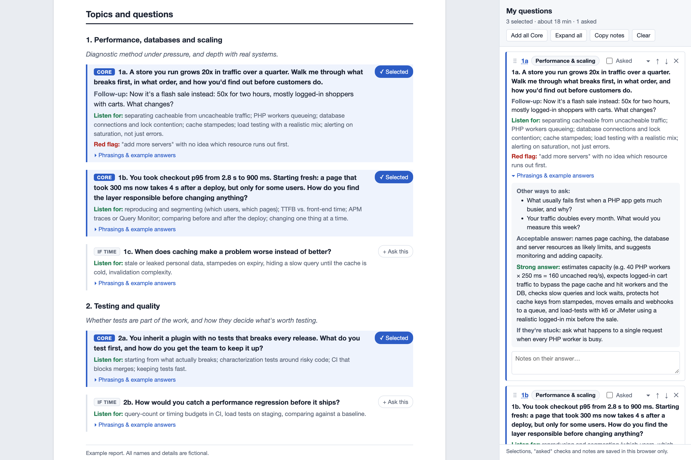

# claude-commands

Shared [Claude Code](https://claude.com/claude-code) skills for the team. Add more as they come up.

## Install

Clone the repo and run the installer:

```sh
git clone https://github.com/renventura/claude-commands.git ~/Sites/claude-commands
cd ~/Sites/claude-commands
./install.sh                 # every skill
./install.sh eod             # or just the ones you name
```

The installer symlinks each skill folder into `~/.claude/skills/`, so `git pull` updates
your installed skills in place. Some skills need more than the folder (a script in
`~/.claude`, a rule in `~/.claude/CLAUDE.md`); those have a `setup.sh` that the installer
runs for them. Re-running is safe. Anything already at a skill's install path is moved to
`~/.claude/skills-backup/` first.

Claude Code picks up new skills without a restart. Run a skill as `/skill-name`. Most
skills also start on their own when your request matches them.

## Skills

| Skill | What it does |
|---|---|
| [`eod`](skills/eod/README.md) | `/eod`: end-of-day report saved as a Slack draft in `#software-eod` |
| [`candidate-interview-prep`](skills/candidate-interview-prep/README.md) | Interview prep for engineering candidates: PDF report plus an interactive HTML page |

### `eod`

Builds an end-of-day report covering everything since your last `/eod` run and saves it
as a Slack **draft** (never auto-sent) in `#software-eod`. It pulls from:
- a log of Linear issues Claude records as you work on them
- your local Claude Code session transcripts
- substantial Slack conversations you took part in
- your Google Calendar meetings

The report is grouped by project under TODAY, FLAGS and NEXT. It only runs when you type
`/eod`.

- **Setup:** `setup.sh` links the issue-logging script into `~/.claude/eod/`, adds the
  logging rule to `~/.claude/CLAUDE.md`, and removes the old `/eod` slash command if you
  had it.
- **Permissions:** merge them from `skills/eod/settings.sample.json` into
  `~/.claude/settings.json` by hand.
- **Requirements:** macOS, and the Slack, Google Calendar and Linear connectors (`/mcp`).
- **Channel:** `#software-eod` is hardcoded. Change the `channel_id` in `SKILL.md` if you
  adapt it for another team.

### `candidate-interview-prep`

Give it a candidate's resume, cover letter and any other files, plus the job posting
(link or file). It produces:
- a PDF with a scored fit assessment, strengths and concerns, an interview plan, and
  questions tailored to the candidate, each with example answers
- an interactive HTML version with a sidebar for picking questions, taking notes and
  tracking what you've asked during the interview

It also supports a per-person interviewer profile (your specialty, interview length,
output folder). Requires Google Chrome and `python3`.



## Adding a skill

Create `skills/<name>/` with a `SKILL.md` (frontmatter `name` and `description`, then the
instructions), plus a `README.md` for people. If it needs anything installed outside its
own folder, add a `setup.sh` that does it idempotently. Then add it to the table above.
