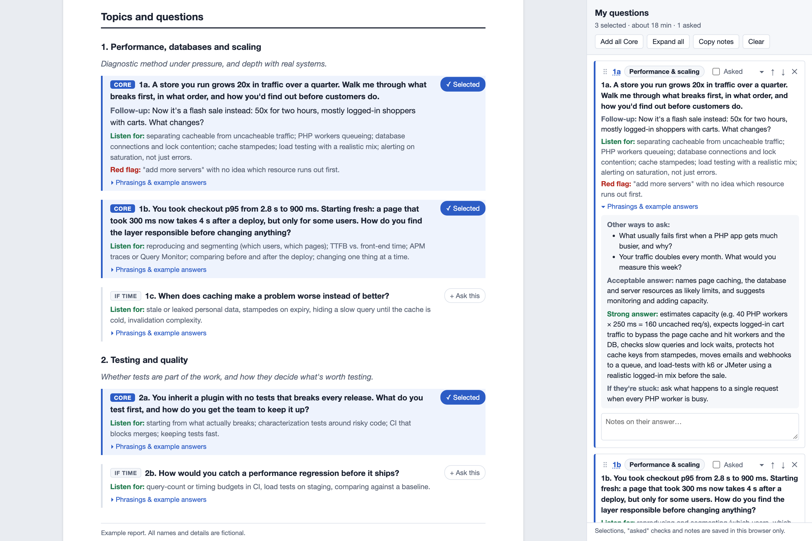

# candidate-interview-prep

A Claude Code skill that prepares you to interview an engineering candidate. Give it the
candidate's files (resume, cover letter, portfolio, anything else) and the job posting
(a link or a file). It produces an interview prep report as a PDF for reading beforehand,
plus an interactive HTML version to run the interview from.



*The HTML report, with three questions picked into the sidebar. To try the sidebar
yourself, open [`docs/example-report.html`](docs/example-report.html) in a browser; the
candidate in it is fictional.*

## What's in the report

- **Pre-interview assessment:** a 1-5 score and a lean (Strong yes ... Strong no), with
  the reasoning and what the interview most needs to confirm.
- **Fit against the role:** every must-have and nice-to-have from the posting, rated
  Strong / Partial / Not evident, with the evidence.
- **Links checked:** claims verified against links the candidate shared (GitHub PRs,
  repos, portfolio).
- **Strengths and concerns to probe.**
- **Interview plan:** a time plan for the interview and what to cut first if you run long.
- **Topics and questions:** 6-9 topics with questions based on the candidate's
  experience. Each question has:
  - a **Core** or **If time** label
  - follow-ups
  - what to listen for, and red flags
  - other ways to ask it
  - acceptable vs. strong example answers
  - a nudge if they get stuck
- **Questions they'll likely ask you.**

Questions focus on reasoning and trade-offs rather than trivia. They're written so you
can judge the answers without knowing the candidate's own products.

## Using the HTML during the interview

Open the `.html` report in a browser:

- Click **+ Ask this** on any question, or **Add all Core**, to add it to the
  **My questions** sidebar.
- In the sidebar:
  - drag questions into order (or use ↑ ↓)
  - expand or collapse the details
  - tick **Asked**
  - take notes on each answer
- **Copy notes** puts the questions, asked status and your notes on the clipboard for
  your write-up.
- Selections, notes and expanded/collapsed state are saved in your browser's
  `localStorage`, keyed by the file's path. They aren't saved into the file, so they
  don't follow the file to another browser, and moving or renaming the file starts
  fresh. If you regenerate a report at the same path, click **Clear** to drop the old
  selections.
- On narrower windows, the sidebar becomes a drawer opened from the
  **My questions** button.

## Requirements

- [Claude Code](https://claude.com/claude-code)
- Google Chrome (or Chromium). It's used headless to load job postings that need
  JavaScript (Rippling, Workday, Greenhouse...) and to print the PDF. No other PDF
  tools are needed.
- `python3`, for the bundled helper scripts. They use the standard library only.
- Optional: the `gh` CLI, for checking GitHub links quickly.
- Optional: `textutil` (built into macOS), for reading `.docx` files.

## Install

Clone the repo and run the installer from its root. It symlinks the skill into
`~/.claude/skills/`, so `git pull` keeps your copy up to date:

```sh
git clone https://github.com/renventura/claude-commands.git ~/Sites/claude-commands
cd ~/Sites/claude-commands
./install.sh candidate-interview-prep
```

### Set up your interviewer profile (recommended)

The skill tailors questions to you: your specialty, interview length and where reports
are saved. Copy the example profile and edit it:

```sh
mkdir -p ~/.claude/candidate-interview-prep
cp ~/.claude/skills/candidate-interview-prep/references/interviewer-profile.example.md \
   ~/.claude/candidate-interview-prep/interviewer.md
```

The profile lives outside the skill folder, so pulling updates never overwrites it.
Without a profile, the skill weights topics only by the job posting.

## Usage

Just ask. For example:

> I'm interviewing a candidate for https://ats.rippling.com/yourco/jobs/1234. Their resume
> and cover letter are at ~/Downloads/Jane Doe Resume.pdf and ~/Downloads/Jane Doe Cover
> Letter.pdf. Prep me for the interview.

Or run `/candidate-interview-prep` and give it the files and link.

You can add instructions in the same message, e.g. "45-minute interview", "focus more on
testing", "this is a first-round screen", or "include a question about accessibility".

Reports are saved to `~/Documents/Interviews/` (or the folder in your profile) as
`<candidate>-<role>-<date>.html` and `.pdf`. Claude prints a short summary in the terminal.

## Customizing

- **Default topics:** `references/default-topics.md`. These are the topics included in
  every interview. Edit them to change what's always covered.
- **Report layout:** `assets/report-template.html`.
- **Your preferences:** `~/.claude/candidate-interview-prep/interviewer.md`.

## Privacy

Reports contain a real applicant's personal information. The skill keeps them on your
machine and won't upload, publish or share them unless you explicitly ask. Keep reports
out of this repo. The skill only evaluates job-related evidence and avoids questions
about protected characteristics.

## Files

```
candidate-interview-prep/
├── SKILL.md                                 instructions Claude follows
├── README.md                                this file
├── assets/report-template.html              report layout, styles and sidebar script
├── docs/                                    README screenshot and a fictional example report
├── references/default-topics.md             topics included in every interview
├── references/interviewer-profile.example.md
└── scripts/
    ├── fetch_job_posting.py                 render a JS-heavy job posting to text
    ├── extract_pdf_links.py                 list link URLs embedded in a PDF
    └── html_to_pdf.sh                       print the HTML report to PDF with Chrome
```
